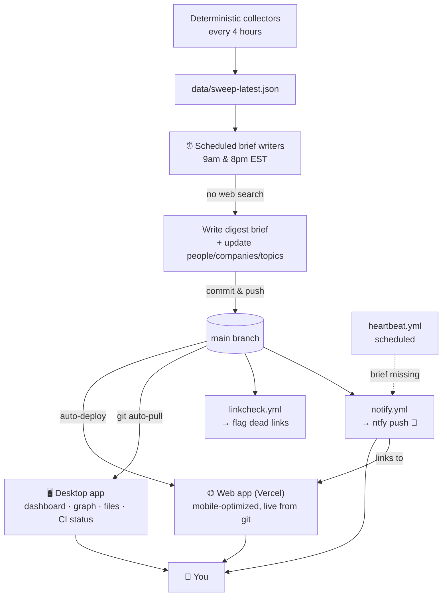

# ai-intel

A **self-updating AI intel wiki**: a living knowledge base about the people,
companies, and ideas moving the AI world — software, and the hardware/compute/
datacenter stack underneath it. Deterministic collectors fetch structured
records from APIs and RSS feeds; scheduled brief writers use those records,
write a short brief, update relevant pages, push to `main`, and ping your phone
with a link to a hosted, mobile-optimized web app. Brief generation must not use
Claude web search or another search tool; see `config/brief-generation.md`.
It's also built to be browsed as an [Obsidian](https://obsidian.md) vault.

**Live:** [ai-krish.vercel.app](https://ai-krish.vercel.app)

## How it works



Collection runs every four hours:
1. Reads `people/`, `companies/`, and `topics/` as the **source of truth** for what to track.
2. Collects Hacker News, Reddit, Polymarket, configured RSS feeds, arXiv papers, SEC EDGAR
   filings, GitHub repositories, and GDELT news records.
3. Includes newsletter RSS feeds from a16z and TLDR alongside the configured feeds.
4. Optionally calls NewsAPI and Mediastack when their keys are configured. These adapters
   are throttled to once per 12 hours and disabled by default.
5. If `TYPESAFE_API_KEY` is configured, sends up to 100 new items per run to Jev for
   structured relevance scoring and topic classification. Prior scores are reused when
   an item appears in consecutive sweeps. Without the key, items are still collected
   without Jev scores.
6. Normalizes records, filters by freshness, removes duplicate URLs, and writes
   `data/sweep-latest.json`. Brief writers select and explain those records; they do not
   perform web search.

Each brief run:
1. Reads collected records and the previous brief, then reports useful new items.
2. Writes a scannable digest to `briefs/<date>-<session>.md` — TL;DR, light section
   headers, one-line bullets in a plain voice, every bullet ending in a real source link.
3. Appends dated, sourced notes to the relevant `people/`, `companies/`, and `topics/` pages.
4. Commits and pushes the brief to `main` first, then the page updates as a second commit.

## Folder structure

```
.claude/skills/humanizer/   Bundled MIT writing-cleanup skill (optional; not in the default pipeline)
.agents/skills/              Project-local Codex skills
.claude/skills/              Project-local Claude Code skills
.github/workflows/          notify.yml · linkcheck.yml · heartbeat.yml
.github/scripts/             deterministic source collectors
AGENTS.md                    Versioned project agent guide
config/brief-agent-prompt.md Versioned brief agent prompt and tool contract
config/sources.json         RSS feed registry
config/brief-generation.md  no-search policy for hosted brief routines
.env.example                Local collector environment template
data/sweep-latest.json      normalized source records for brief generation
briefs/                     Dated digests: YYYY-MM-DD-{morning,evening}.md
people/                     One page per tracked person (name, handle, tags:[person])
companies/                  One page per tracked public company (name, ticker, layer, tags:[company])
topics/                     One page per topic (title, tags:[topic])
app/                        Desktop reader app (Electron: dashboard, graph, files)
web/                        Hosted reader app (Next.js: briefs, people, companies, topics, graph)
README.md                   This file
```

- **`people/` and `companies/` are starting whitelists, not hard limits.** Add a
  `people/<slug>.md` (`name`, `handle`, `tags: [person]`) or `companies/<slug>.md`
  (`name`, `ticker`, `layer`, `tags: [company]`) and the next run tracks them; remove
  the file to stop. The filename (no `.md`) is the wikilink slug, e.g. `[[karpathy]]`.
  New people and companies can be added when collected records make them relevant;
  agents should not invent entities or create speculative graph links.
  Each page carries a short bio; the routine appends dated, sourced notes under `## Recent`.
- **`companies/`** covers public companies across the AI hardware/datacenter supply chain --
  compute, memory, networking, storage, power, cooling, and building & site (see
  [[ai-datacenter-stack]]) -- plus the TMT names around them. The routine tracks
  stock-moving news (earnings, capex guidance, supply agreements) alongside product news.
- **`topics/`** works the same way for themes; its filenames are the topic slugs.

## Automation

- **Routine** (claude.ai/code): one API-only brief writer handles morning and evening
  runs. GitHub Actions is the sole scheduler. The
  [`fire-claude-routines.yml`](.github/workflows/fire-claude-routines.yml) workflow
  triggers it through Anthropic's routine API at 9:00 AM and 8:00 PM New York time.
  It remains disabled until the `CLAUDE_ROUTINES_VIA_API` repository variable is set to
  `true` and the routine's token is added as an Actions secret. The routine invokes
  `ai-intel-brief` and follows the versioned prompt at
  [`config/brief-agent-prompt.md`](config/brief-agent-prompt.md). Keep the two old
  time-based routines paused to avoid duplicate runs. Manage it at
  https://claude.ai/code/routines.
- **`sweep.yml`** — every four hours, collects source records into
  `data/sweep-latest.json` without web search. Jev optionally adds structured scores
  and topic labels through the TypeSafe API.
- **`notify.yml`** — on each new brief, sends an [ntfy.sh](https://ntfy.sh) push
  (topic `ai-intel`) with a one-line summary + link to the brief on the hosted
  web app; tap opens it. Subscribe in the ntfy app to topic `ai-intel`.
- **`linkcheck.yml`** — verifies the brief's source links resolve; alerts on
  dead/invented ones (404/410/unreachable).
- **`heartbeat.yml`** — shortly after each window, alerts if the expected brief
  never landed, so a failed run can't pass as a quiet day.

## Run your own copy

It's just markdown + GitHub Actions + Claude Code routines, so you can fork it and
point it at your own interests:

1. **Fork the repo**, then edit `people/` and `topics/` to track who and what you
   care about (one file each — see [Folder structure](#folder-structure)).
2. **Create one API-only brief routine** at
   [claude.ai/code/routines](https://claude.ai/code/routines), pointed at your fork.
   Its prompt should invoke the `ai-intel-brief` skill and follow
   [`config/brief-agent-prompt.md`](config/brief-agent-prompt.md). GitHub Actions sends
   the morning/evening mode and provides the schedule.
3. **Allow direct pushes** — in the routine's repo permissions, enable
   **Allow unrestricted git push** so it can commit straight to `main` (or adapt
   the prompt to open PRs instead).
4. **Choose an ntfy topic** — replace `ai-intel` with your own (ideally
   unguessable) topic in `.github/workflows/notify.yml` and `heartbeat.yml`, then
   subscribe to it in the [ntfy](https://ntfy.sh) app.
5. **Enable GitHub Actions** on your fork (they power collection, notifications,
   link-checking, and the missed-run heartbeat). ntfy topics are public and those
   workflows just `curl` them.
6. **Configure collector credentials** as needed. For local collection, copy
   `.env.example` to `.env` and fill the needed values. Keep `.env` local; it is ignored
   by Git. In GitHub, add `TYPESAFE_API_KEY`, Reddit OAuth credentials, and optional
   provider keys as repository secrets. EDGAR's `SEC_USER_AGENT` belongs in repository
   variables. Jev scoring is enabled by its API key. Reddit OAuth uses
   `REDDIT_CLIENT_ID` and `REDDIT_CLIENT_SECRET`; EDGAR's `SEC_USER_AGENT` needs an
   identifying name and contact email. `NEWSAPI_KEY` and
   `MEDIASTACK_KEY` enable optional news aggregators; check provider plan terms and
   quotas before enabling them.
7. **(Optional) trigger Claude routines through the API.** Use one API-only routine for
   both morning and evening runs. Store its per-routine token as
   `CLAUDE_AI_INTEL_ROUTINE_FIRE_TOKEN` in GitHub Actions secrets, then set the
   `CLAUDE_ROUTINES_VIA_API` repository variable to `true`. The workflow's manual
   **Run workflow** menu can trigger either mode. Anthropic returns a session link as
   soon as the run is created; the run continues in Claude Code. API fires use Claude
   Code subscription usage, not Claude Platform API billing.
8. **(Optional) the desktop app** — `cd app && npm install && npm start`. Its CI
   panel uses the [GitHub CLI](https://cli.github.com) (`gh auth login`).
9. **(Optional) the web app** — deploy [`web/`](web/) to [Vercel](https://vercel.com)
   (Root Directory: `web`) for a hosted, mobile-optimized reader. It reads the same
   markdown at build time, so it redeploys automatically on every push to `main`.
   Point `notify.yml`'s `WEB_APP_URL` at your deployment so notifications link there.

## Web app

A hosted Next.js reader lives in [`web/`](web/) — the mobile-first way to read this
wiki, deployed on [Vercel](https://vercel.com) and rebuilt automatically on every
push to `main`. Same five views as the desktop app, tuned for a phone:

- **Briefs / People / Companies / Topics** — searchable list pages with an
  iOS-Contacts-style index scrubber for fast alphabetical/date jumping.
- **Graph** — a touch-friendly (pinch-to-zoom, tap-to-open) force-directed map of
  briefs ↔ people ↔ companies ↔ topics, filterable by date range and node type.
- A bottom dock (glass/blur effect) replaces a nav bar; PWA metadata (favicon,
  Open Graph/Twitter cards) is generated from the desktop app's icon.

```bash
cd web && npm install && npm run dev   # run locally at localhost:3000
npm run build                           # production build (what Vercel runs)
```

## Desktop app

A standalone Electron reader lives in [`app/`](app/) — a purpose-built mini-Obsidian for
this vault, so you don't need Obsidian at all. Three views over the same markdown:

- **Dashboard** — next-run time, stats, recent briefs, the latest brief rendered inline,
  and a live status panel: whether you're behind `origin` (click to pull) and the latest
  GitHub Actions run for each workflow (notify · link-check · heartbeat, via the `gh` CLI).
- **Graph** — force-directed map of briefs ↔ people ↔ topics, from frontmatter + `[[wikilinks]]`.
- **Files** — a collapsible file tree of the vault + a reader.

It auto-pulls from GitHub (every 10 min + on launch) and live-reloads on file changes, so
new briefs appear on their own.

```bash
cd app && npm install && npm start   # run from source
npm run dist                          # build a macOS .app + .dmg into app/dist/
```

See [`app/README.md`](app/README.md) for details.

## Obsidian (optional)

The desktop app above is the primary way to read this wiki, but since it's just a
folder of markdown, you can also open it in [Obsidian](https://obsidian.md) if you
prefer (`Open folder as vault`, pointed at the repo root). You get wikilinks,
backlinks (each person/topic page shows every brief that mentioned it), the graph
view, and tag filtering (`person` / `topic` / `brief`).

If you go the Obsidian route, install the **Obsidian Git** plugin and enable
auto-pull so new briefs sync to your vault (the routines push to GitHub, not to
your machine).

## Sources and limits

`config/sources.json` controls direct RSS feeds, including a16z News, a16z AI Policy
Brief, a16z Dispatches from the Frontier, and TLDR's flagship, AI, Dev, and Hardware
newsletters. The collector reads their RSS/Atom feeds directly, so these sources do not
need a newsletter-to-RSS scraping service. The sweep also includes Hacker News
Algolia, Reddit OAuth/public JSON fallback, Polymarket Gamma, arXiv, SEC EDGAR, GitHub
repository search, and GDELT. NewsAPI and Mediastack are optional keyed adapters. The
GitHub Trending page is collected as a public HTML source because GitHub does not expose
an official trending API. This parser can need maintenance if GitHub changes the page
markup. The Reddit browser-session approach is not part of the GitHub-hosted sweep
because it needs a logged-in local Chrome session.

NewsAPI's free Developer plan is limited to development/testing and delayed data; it is
not enabled by default. Mediastack's free tier has a low monthly request quota and delayed
data. Enable either only when its plan terms and quota suit the intended use.

## A note on accuracy

Briefs are generated from collected source records. The link-check catches dead URLs,
but it can't verify that every claim is true — treat briefs as leads, not gospel, and
follow the cited sources.

## License

MIT — see [LICENSE](LICENSE). The bundled humanizer skill is MIT, adapted from
[blader/humanizer](https://github.com/blader/humanizer).
