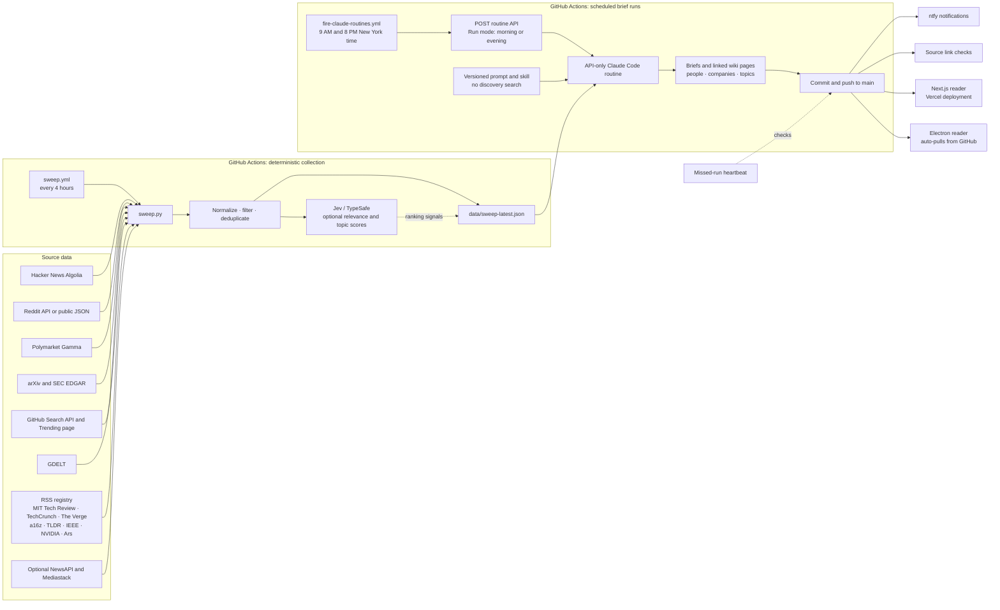

# ai-intel

Collects AI and tech updates from APIs, RSS, and research feeds, then turns them into
cited briefs and linked wiki pages.

## System

GitHub Actions schedules the API-only Claude routine. The routine has no timer of its
own. Its task prompt and Claude skill live in the repo; collected records are the only
story-discovery input. The graph comes from links among briefs, people, companies, and
topics.

## Set up

1. For local collection, copy `.env.example` to `.env` and add credentials. `.env` is
   ignored by Git. Run a sweep with `python3 .github/scripts/sweep.py`.
2. For GitHub Actions, add `TYPESAFE_API_KEY`, Reddit credentials, and any optional
   provider keys as repository **secrets**. Set `SEC_USER_AGENT` as a repository
   **variable**. GitHub supplies `GITHUB_TOKEN` automatically.
3. Add `CLAUDE_AI_INTEL_ROUTINE_FIRE_TOKEN` as a repository secret and set
   `CLAUDE_ROUTINES_VIA_API=true` as a repository variable. The routine token is
   generated in Claude Code. The routine fire workflow starts disabled until enabled.
   Keep the older time-based routines paused.

For a fork, create an API-only Claude routine and replace the routine ID in
`.github/workflows/fire-claude-routines.yml` with yours.

## Sources

The collector uses Hacker News, Reddit, Polymarket, arXiv, SEC EDGAR, GitHub, GDELT,
and the RSS feeds in `config/sources.json`. NewsAPI and Mediastack are optional. Jev
scores items when `TYPESAFE_API_KEY` is set; scores affect ranking, not story facts.
GitHub Trending is read from its public HTML page, so GitHub markup changes may require
parser updates.

## Readers

- Desktop: `cd app && npm install && npm start`
- Web: `cd web && npm install && npm run dev`

MIT license. Collector and agent settings: `config/`, `.github/scripts/`, and
`.agents/skills/ai-intel-brief/`.
